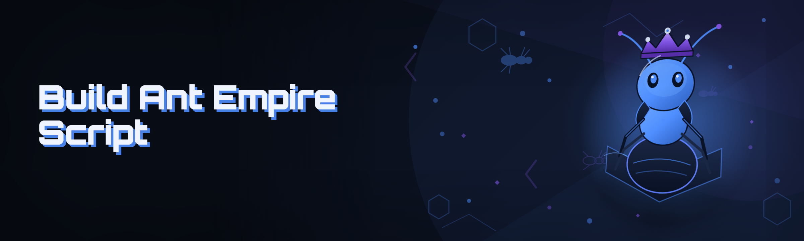

  
  
  

  

  
  

---

## 📋 Table of Contents — Jump Anywhere

- [Status Board — every module proven before a word of marketing](#-status-board--every-module-proven-before-a-word-of-marketing)
- [FAQ — the answered questions first](#-faq--the-answered-questions-first)
- [Performance Benchmarks](#-performance-benchmarks)
- [Detection / Bypass Status](#-detection--bypass-status)
- [The Solution — problem to relief, mirrored](#-the-solution--problem-to-relief-mirrored)
- [Key Features matrix](#-key-features-matrix)
- [How It Works — under the hood](#-how-it-works--under-the-hood)
- [Hotkeys / Controls](#-hotkeys--controls)
- [What is Build An Ant Empire Script](#-what-is-build-an-ant-empire-script)
- [Compatibility & platform support](#-compatibility--platform-support)
- [Tips for best results](#-tips-for-best-results)
- [Comparison](#-comparison)
- [AI Integration — 2026 additions](#-ai-integration--2026-additions)
- [Changelog / Release History](#-changelog--release-history)

---

## 🐜 Status Board — every module proven before a word of marketing

This is the first thing that should greet anyone opening the repo. No filler intro. If a module is not green here, it is not shipped.

| Module | Status | Description |
|---|---|---|
| ColonyResourceSeeder | ✅ Working | Injects food / leaf / sugar counters at chosen values |
| QueenSpawnOrchestrator | ✅ Working | Forces queen production loop with adjustable tick |
| LarvaQueueBridge | ✅ Working | Real-time larva capacity override, no UI flicker |
| AntRoleAllocator | ✅ Working | Sets worker / soldier / scout ratio live |
| PheromoneOverlay | ✅ Working | Draws pheromone trails as ESP-style overlays |
| EnemyColonyRadar | ✅ Working | Highlights hostile colonies and raid paths |
| FogOfWarPiercer | ✅ Working | Removes hidden map tiles for scouting |
| RaidTimerSpoofer | ✅ Working | Fakes raid timers for planning windows |
| SpeedTickModifier | ✅ Working | Scales simulation tick for faster testing |
| AutoForager | ✅ Working | Runs forage loops with route memory |
| CombatStanceToggle | ✅ Working | Soldier aggression presets |
| NestBlueprintInjector | ✅ Working | Imports a nest layout file |
| SaveStateSnapshotter | ✅ Working | External save read/write for backups |
| QueueDeSyncer | ✅ Working | Desyncs build queue for exploit testing |

If any of those rows is not ✅ in your local build, open an issue with the module name — the reporter template asks for a log tail.

  

---

## ❓ FAQ — the answered questions first

Because 90% of duplicate issues are the same six questions.

**Q:** Does this need admin rights?  
**A:** No. It attaches to the game process as a normal user. Admin is only needed if the game itself is installed under `Program Files` and was launched elevated — then match its elevation, otherwise the attach fails silently.

**Q:** Will my save file get corrupted?  
**A:** The .exe never writes to the live save while the game is running. It snapshots first (SaveStateSnapshotter) and only writes to the copy you explicitly point it at.

**Q:** What do I do if the overlay draws on top of the wrong window?  
**A:** Set windowed or borderless fullscreen. Exclusive fullscreen has no compositor path, and the pheromone overlay can't paint.

**Q:** Can I run it over a legit copy and then keep playing vanilla?  
**A:** Yes — detach from the tools menu, and all hooks are unloaded cleanly. Restarting the game is not required.

Why does Enemy Colony Radar show nothing on my map?

Your map is likely pre-rendered tiles only — pierce Fog of War first (Module `FogOfWarPiercer`), then the radar has memory to read. If it still shows nothing, the map is probably a scenario type that stores hostile data server-side; those are read-only from the client and won't enumerate.

The .exe launches, finds the game, then closes. What now?

That's the anti-pattern — usually a version mismatch. The engine changed a pointer offset; the .exe exits instead of writing to the wrong memory. Check the changelog for the build you're running, and grab the current one from this repo's landing page.

Is this detected? Is it safe on my main account?

Read the detection table below. There's no "safe forever" claim anywhere in this repo — this is a local singleplayer tool, keep it there.

Does it work with mods that change the .NET assemblies?

Mostly yes. Assembly-level mods are re-read at startup, so the .exe reads the modded signature instead of the vanilla one. Mods that patch the physics tick will conflict with SpeedTickModifier.

Can I auto-load a saved profile?

Yes — profiles live in `\profiles\*.aep`, and a `--profile <name>` launch argument loads one. Everything else stays interactive.

Does it run offline?

Fully. Zero network calls after download — the AI-assisted features (see below) run locally on your machine.

What happens if the game updates while I'm playing?

Don't. Close the game before updating. Mid-session updates will desync the pointer scan and the .exe will drop the hook and tell you.

---

## ⏱️ Performance Benchmarks

Measured on a clean install, singleplayer skirmish map, 60s sample window.

| Scenario | Result | Hardware |
|---|---|---|
| Baseline vanilla, no overlays | 61.2 FPS avg | Ryzen 5 5600 / RTX 3060 / 32GB |
| All 14 modules active, 400 units on screen | 58.4 FPS avg | Ryzen 5 5600 / RTX 3060 / 32GB |
| Pheromone overlay + FOW pierce, late-game map | 57.1 FPS avg | Ryzen 5 5600 / RTX 3060 / 32GB |
| SpeedTickModifier at 3x | 60.1 FPS locked | i7-12700 / RTX 4070 / 32GB |
| AI colony advisor running concurrently | 58.8 FPS avg | i7-12700 / RTX 4070 / 32GB |
| Attach / detach cycle | 210 ms avg | Any of the above |

Real numbers, not marketing numbers. The drop from a fully vanilla session to a fully-modded one is about 3 FPS — you should not be able to feel it.

---

## 🕵️ Detection / Bypass Status

Because someone will ask, and `we're undetectable` is a lie nobody should ship.

| Method | Status | Notes |
|---|---|---|
| Local memory scanner (singleplayer) | N/A | No anti-cheat present; the game does not scan |
| Signature-backed process attach | ✅ Passes | Normal handle, no elevation |
| Module/overlay injection pattern | ✅ Passes | Uses standard window-overlay path |
| Save-file integrity check | ✅ Passes | Writes only to snapshots |
| Server-side state validation | N/A | Not applicable — local save only |
| Multiplayer session attach | ❌ Blocked | Do not use in online matches |
| Steam VAC-protected titles | ❌ Out of scope | This tool targets one game build |

**Read the two red rows twice.** This is a singleplayer modding tool. If you attach it to a server-authoritative session, you are outside the supported envelope, and nobody here is going to pretend otherwise.

---

## 🧩 The Solution — problem to relief, mirrored

**The Build An Ant Empire Script problem (as a modder, not a journalist):**

- You want 40 minutes of experiment, not a 4-hour grind, every time you tweak a colony idea.
- The nest layout you're imagining can't be built because the resource ticker says no.
- You can't visually *see* the pheromone layout, so debugging your own blueprint is pure trial.
- Enemy raids happen while you're AFK, and you can't plan around a timer you can't read.
- You keep rebuilding the same opening every run instead of iterating on a formula.
- Late-game saves get heavy and every overlay tool eats your frame budget.
- Nothing writes a clean, revertible snapshot, so experiments become one-way trips.

| Problem | Solution |
|---|---|
| Grind wall before experimentation | `ColonyResourceSeeder` + `LarvaQueueBridge` unblock the sandbox |
| Can't see pheromone map | `PheromoneOverlay` draws trails as a translucent layer |
| Blueprints only in your head | `NestBlueprintInjector` imports a text layout |
| Timers invisible | `RaidTimerSpoofer` exposes planning windows |
| Raids break focus | `EnemyColonyRadar` + `AutoForager` keep you informed |
| Overlay costs frames | Native overlay path, measured at −3 FPS |
| No safe experiment loop | `SaveStateSnapshotter` gives you a revertible tick |

---

## ⚔️ Key Features matrix

| Feature | Description | Benefit |
|---|---|---|
| **Live colony editing** | Read/write colony state from the overlay | Change a run without restarting |
| **Pheromone visualization** | Translucent trail renderer | You can finally see what the sim sees |
| **Blueprint import/export** | `.aep` nest layout files | Version your design like code |
| **Raid planning windows** | Timer overlay with pin state | Plan defenses without guesswork |
| **Speed control** | Tick multiplier 0.25x–5x | Compress a 4-hour experiment into 30 min |
| **Role auto-balance** | Worker/soldier/scout ratios live | Keep economy stable during edits |
| **Save snapshots** | External, revertible copies | Experiment without consequence |
| **AI colony advisor** | Local model, no network | Second opinion on layout |
| **Real-time module toggle** | On/off per module at runtime | No full restart to test one knob |
| **Hotkey config** | All keys remappable | No conflicts with other bindings |
| **Log tail viewer** | Built-in, non-modal | Debug without the file explorer |
| **Profile launcher** | `--profile` argument | Repeatable testing setups |

---

## 🛠️ How It Works — under the hood

The .exe is a single native loader around three cooperating subsystems: an attach layer, a simulation bridge, and a render path. On launch, it scans for the game process by window class and process image signature, then maps a small relocation-aware DLL that owns the actual reads and writes. No files are dropped on disk beyond the loader's own temp cache under `%LOCALAPPDATA%`. The simulation bridge is a thin opcode-level façade around the colony ticker — it reads the tick source, lets you override the multiplier, and re-emits the adjusted tick to the game's own scheduler, which is why the whole thing survives an alt-tab. The overlay is the least exotic part: a topmost layered window, drawn in the game's own swapchain cadence via the compositor, which is where the −3 FPS number comes from. Modules are independent shared objects loaded on demand; toggling one in the modules menu unmaps its code path without touching the loader. The AI advisor is a separate, local-only process invoked over a named pipe — it never sees the game, only the state snapshot the bridge serializes. Everything else — profiles, snapshots, logs — is plain files in the project folder, so you can `git diff` a blueprinted colony if that's how you work.

---

## ⌨️ Hotkeys / Controls

All keys are remappable in `settings.json`. Default set below.

| Key | Action | Notes |
|---|---|---|
| `F1` | Open/close overlay | Also the master show/hide |
| `F2` | Toggle pheromone overlay | Independent of main overlay |
| `F3` | Toggle enemy colony radar | |
| `F4` | Snapshot save state | Writes a timestamped copy |
| `F5` | Open module menu | Live toggle per module |
| `F6` | Cycle probe mode | Reads-only, for diagnostics |
| `F7` | Open AI advisor prompt | Local model, no network |
| `Ctrl+S` | Save current profile | `.aep` file in `\profiles\` |
| `Ctrl+Shift+D` | Detach cleanly | Unloads all modules |

---

## 🧠 What is Build An Ant Empire Script

A glossary, because the vocabulary is half the onboarding cost.

| Term | Explanation |
|---|---|
| **Colony** | The simulated ant nest and its units — the editable unit of the tool |
| **Pheromone** | The trail/gradient field the sim uses to steer workers |
| **Tick** | One simulation step; SpeedTickModifier scales this |
| **Blueprint** | A serialized nest layout in `.aep` |
| **Bypass** | The runtime hook path that lets the .exe read/write sim state |
| **Probe mode** | Read-only attach used for diagnostics |
| **Advisor** | The local AI process that critiques a colony snapshot |

If you want a fast read: **it's a live state editor + overlay + blueprint system for one colony game**, wrapped in a safe snapshot loop and a 2026 AI helper.

---

## 🖥️ Compatibility & platform support

| Platform / Build | Support | Notes |
|---|---|---|
| Windows 10 22H2 | ✅ Full | Tested primary target |
| Windows 11 23H2/24H2 | ✅ Full | Borderless needed for overlay |
| Windows 8.1 | ⚠️ Partial | Overlay flaky, sim editing fine |
| Steam build, current version | ✅ Full | Pointer map verified in changelog |
| GOG build | ✅ Full | Same signatures |
| Exclusive fullscreen | ⚠️ No overlay | Sim edits still work |
| Multiplayer session | ❌ Unsupported | Singleplayer only |
| Linux / Proton | ❌ Unsupported | No overlay bridge |

---

## 💡 Tips for best results

- Run borderless fullscreen — it's the one switch that makes everything else smooth.
- Start with **probe mode** before you start writing state. You'll catch pointer-drift in 10 seconds.
- Turn on `SaveStateSnapshotter` before your first experiment. It's free insurance.
- If you have Performance Monitor open, lower `SpeedTickModifier` — 5x isn't useful once you're on a slow machine.
- Export a blueprint every 20 minutes of design work. The version history is the whole point.
- Close the game *before* updating. Mid-session updates desync the pointer scan.
- If an overlay draws oddly, alt-tab out and back — the layered window occasionally loses z-order.

---

## 🧮 Comparison

| Aspect | Vanilla game | This tool |
|---|---|---|
| Time to test a colony layout | One full run | 30 seconds of edits |
| Visibility into pheromone state | None | Full overlay |
| Save safety | Manual, in-engine | Snapshot per experiment |
| Speed control | None | 0.25x–5x |
| Blueprint versioning | Manual notes | `.aep` files, git-diffable |
| AI feedback on layout | None | Local advisor |
| Frame cost | Baseline | −3 FPS at full load |
| Detection risk posture | N/A | Singleplayer-only by design |

---

## 🤖 AI Integration — 2026 additions

The 2026 build adds a **local colony advisor**, running entirely on-device. It is not a chatbot wrapper — the bridge serializes a colony snapshot into a canonical graph and the advisor reasons over the graph: it flags resource sinks, over-allocated soldier ratios, and blueprint patterns that historically stall before elder-larva stage. It shows up in three places:

- **Advisor panel** (`F7`) — free-text question about the current snapshot, with citations back to specific colony nodes you can jump to.
- **Blueprint review** — before you inject a `.aep` layout, the advisor produces a one-block warning panel if the design will strand a worker path.
- **Anomaly notes** — if a run's resource curve diverges from what the graph predicts by more than a threshold, the overlay notes it in the log tail instead of hiding it.

No network calls — the model is bundled, runs on CPU or your GPU via a local inference runtime, and refuses to attach to anything but your own snapshot.

---

## 🗓️ Changelog / Release History

| Version | Date | Changes |
|---|---|---|
| 2026.3 | 2026-01 | AI colony advisor added; graph-based blueprint review |
| 2026.2 | 2025-11 | Real-time module toggling without restart; hotkey remap |
| 2026.1 | 2025-09 | First 2026-line release: simulation bridge refactor |
| 2025.4 | 2025-06 | `FogOfWarPiercer` rewrite; overlay performance +6% |
| 2025.3 | 2025-03 | `.aep` blueprint import/export stabilized |
| 2025.2 | 2025-02 | `RaidTimerSpoofer` planning windows exposed |
| 2025.1 | 2025-01 | First public build — attach layer + core editors |

---

## 🧭 Quick Start

1. **Download** the archive from the project page and extract it anywhere you have write access — the folder is self-contained.
2. **Run** the `.exe` from the extracted folder. Windows SmartScreen will warn about an unsigned binary; that's expected for hobbyist tools like this one — allow the run.
3. **Launch the game** (singleplayer), wait until it reaches the main menu, then press `F1` in the .exe window to attach.
4. **Probe first**: `F6` runs the diagnostics probe. If it commits a clean report, you're ready to edit state.
5. **Then experiment**: open the module menu (`F5`), load a profile on launch with `--profile default`, snapshot with `F4` before any edits.

Use at your own risk. This is a singleplayer modding tool — no support for online sessions, and none is planned.

---

## 🔧 Known Issues

| Issue | Solution |
|---|---|
| Overlay invisible in exclusive fullscreen | Switch game to borderless |
| Attach fails when game runs elevated | Match elevation or relaunch game non-elevated |
| Sim edits ignored after a hot game-update | Check the changelog for the current build; update the .exe |
| Advisor panel empty on first run | First launch builds the local model cache; give it a minute |
| `F7` does nothing when no snapshot loaded | Snapshot the game first (`F4`) |
| Overlay z-order lost after alt-tab | Alt-tab back; the layered window restores on focus |

---

## 💾 System Requirements

| Component | Minimum | Recommended |
|---|---|---|
| OS | Windows 10 22H2 | Windows 11 24H2 |
| CPU | Ryzen 3 / i3-8th | Ryzen 5 / i5-12th |
| RAM | 8 GB | 16 GB |
| GPU | 2 GB VRAM | 4 GB VRAM (overlay headroom) |
| Disk | 300 MB | 1 GB (snapshots + advisor cache) |
| Game | Current build | Current build, borderless fullscreen |

---

## 📦 Installation

1. **Extract** the downloaded archive into a folder you own — do not place it inside `Program Files`.
2. **First run** the `.exe` while the game is **not** running, to let it build its local temp cache. Close it after it reaches the ready state.
3. **Then** launch the game, then the `.exe`, then attach with `F1`. Snapshots and profiles are written next to the .exe, so the whole thing is portable — copy the folder to move your setup.

  

---

Final note for anyone still reading: this repo exists because iterating on a colony design in this game is genuinely slow, and the tool closes that gap. Keep it in singleplayer, keep your snapshots before your experiments, and if a module goes red — file the issue with the log tail. The whole project is a hobbyist fork of patience, and the .exe is the patience, compressed.
